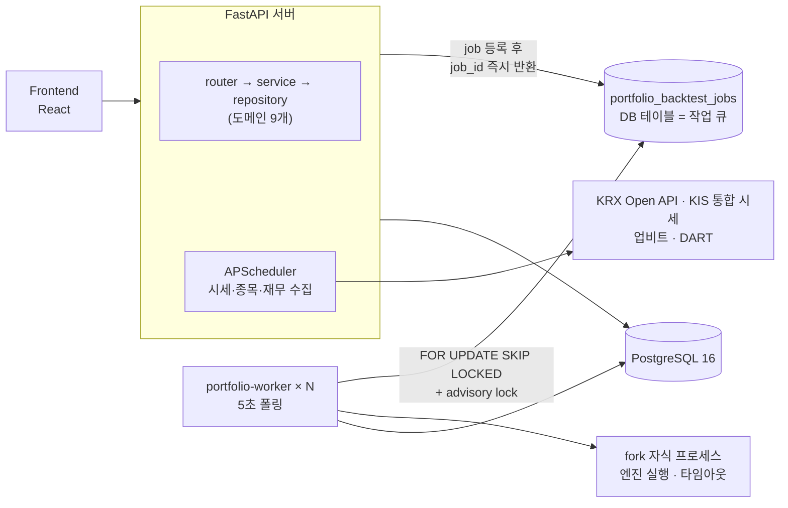

# BackTest Platform

국내 주식·암호화폐 매매 전략을 과거 시세로 검증하는 백테스팅 플랫폼입니다.

- **팀** 2인 (백엔드 김준혁, 프론트엔드 1명) · 2026.05 – 진행 중
- **내 역할** 백엔드 리드. 기획·설계와 백엔드 전체를 맡았고, 전체 커밋의 91.5%(292/319)를 작성했습니다.
- **원본 코드는 비공개**입니다. 시세 데이터 재배포 약관과 보안 정리 때문이며, 이 저장소에는 설계와 문제 해결 기록을 정리했습니다.

| 규모 | 값 |
|---|---|
| 일봉 시세 | 약 930만 행 |
| 종목 | 국내 주식 약 4,000종목 + 암호화폐 |
| 백테스트 가능 구간 | 13.6년 (3,335거래일) |
| 테스트 | 1,309개 통과, 실패 0 |

---

## 아키텍처

- 백테스트 엔진은 **DB에 의존하지 않는 순수 함수**입니다. 필요한 데이터는 service가 계산해 주입합니다.
- 워커는 API와 같은 이미지를 쓰고 command만 다르게 해 컨테이너 복제로 늘립니다.

---

## 해결한 문제

### 1. 메시지 브로커 없이 PostgreSQL로 만든 작업 큐

**문제** 전 종목 포트폴리오 백테스트는 수십 초~수 분이 걸려 HTTP 요청 안에서 동기로 응답할 수 없었습니다. 또 한 사용자가 여러 건을 동시에 돌리면 워커를 독점했습니다.

**해결**
- 요청은 job으로 등록하고 `job_id`를 바로 돌려준 뒤, 클라이언트가 폴링하는 구조로 분리했습니다.
- 워커는 `SELECT … FOR UPDATE SKIP LOCKED`로 서로 다른 job을 집어 행 경합을 피합니다.
- SKIP LOCKED만으로는 두 워커가 같은 사용자의 **서로 다른** job을 동시에 집을 수 있어서, `pg_try_advisory_xact_lock(ns, user_id)`로 사용자 단위 잠금을 잡은 뒤 실행 중인 job이 없는지 **다시 확인**합니다.
- 실제 PostgreSQL에서 8개 스레드가 동시에 job을 집는 테스트를 5회 반복해 사용자당 1건이 지켜지는지 검증했습니다.
- 폴링 실패 경로에서 트랜잭션이 `idle in transaction`으로 남아 마이그레이션(DDL)을 막던 문제를 찾아 rollback을 추가했습니다.

**판단** Celery + Redis를 검토했지만 비동기 작업이 이 기능 하나뿐이고 job이 분 단위라 5초 폴링 지연이 문제 되지 않아 보류했습니다. 대신 API 계약(job 등록 → 폴링)을 고정해 나중에 브로커로 바꿔도 클라이언트는 그대로 쓸 수 있게 했습니다.

### 2. 5년 백테스트 메모리 부족(OOM) → 메모리 74% 감소

전 종목 5년 백테스트가 메모리 부족으로 죽었습니다. 부모·자식 프로세스의 메모리를 따로 측정하며 원인을 하나씩 분리했고, **모든 단계에서 결과가 변경 전과 같음을 해시로 확인**했습니다.

| 단계 | 원인 | 결과 |
|---|---|---|
| 1 | ORM 객체(행당 약 1.2KB)를 세션이 계속 붙잡음 | 1년 부모 메모리 2,942 → 1,238MB |
| 2 | fork로 물려받은 데이터를 자식이 건드려 복사 발생 | 3년 OOM → 정상 종료 |
| 3 | 유니버스가 사실상 전 종목 | 상위 N으로 제한, 5년 OOM → 138.5초 정상 종료 |
| 4 | 327만 행을 행 객체로 한꺼번에 보유 (부모 메모리의 93%) | 숫자 칼럼을 서버 커서로 로딩, **부모 3,916 → 1,017MB**, 동시 2건 실행 가능 |
| 5 | 한 사용자가 워커 독점 | 사용자당 동시 1건 + 워커 수 산정식 |

기대보다 효과가 작았던 시도(미보유 종목 지연 평가, 172초 → 133초)도 기록으로 남기고 가정이 틀린 이유를 분석했습니다.

### 3. 시세 조회 약 35배 개선

**문제** 포트폴리오 백테스트가 종목마다 쿼리를 날리는 N+1 구조였고, 시세 테이블에 조회 패턴에 맞는 인덱스가 없었습니다.

**해결** 단일 벌크 쿼리로 바꾸고, `(market_id, timeframe, time)` 복합 인덱스를 추가했습니다. 등호 조건을 앞에, 범위 조건(시간)을 뒤에 두었고, 운영 중인 큰 테이블이라 `CREATE INDEX CONCURRENTLY`로 무중단 생성했습니다. 실행계획이 Seq Scan에서 Index Scan으로 바뀌었습니다.

실제 DB(약 930만 행)에서 100종목 × 5년 조회, 3회 중 최솟값:

| | 종목당 1쿼리 (N+1) | 벌크 1쿼리 |
|---|---|---|
| 인덱스 없음 | 10.73초 | 0.48초 |
| 복합 인덱스 | 0.27초 | **0.31초** |

두 변경은 어느 하나만으로도 문제를 없앱니다. 실제로 가장 큰 효과를 낸 것은 복합 인덱스였습니다.

### 4. GIL에 묶인 스캔 API를 프로세스로 분리

**문제** 전 종목 스캔이 API 서버 스레드 안에서 돌아, 동시 4건이면 각각 87초가 걸리고 다른 가벼운 API까지 최대 1.8초 밀렸습니다.

**해결** 스캔을 fork 자식 프로세스에서 실행하고 동시 상한과 시간 제한을 두었습니다. 자식은 물려받은 DB 커넥션 풀을 버리고 새 세션을 엽니다.

**결과** 동시 4건 각 87초 → 15.8초, 다른 API 최대 지연 1.8초 → 9ms. 응답은 변경 전과 동일합니다.

### 5. 대체거래소(NXT) 출범 뒤 시세 누락 규명

**문제** 2025.03.04 NXT 출범 이후 기존 데이터 소스가 KRX 체결분만 제공해, 백테스트의 토대인 거래량이 42~58% 빠져 있었습니다.

**해결** 소스별 거래량을 대조해 원인을 확인하고, 증권사(KIS) 통합 시세(KRX+NXT)로 수집 소스를 교체했습니다. 백필 후 API 원본과 9,103종목 × 5개 필드를 대조해 불일치 0건, 중복 0건을 확인했습니다.

또 수정주가 대신 **원주가와 가격 조정 이벤트(액면분할·병합 4,856건)를 분리 저장**하고 조회 시점에 환산합니다.

### 6. 생존자 편향 방지

**측정** 같은 전략을 "오늘 살아 있는 종목"과 "그날 실제 상장돼 있던 종목"으로 각각 돌려, 3년 수익률이 15~33%p 달라지는 것을 슬롯 5개 설정 모두에서 확인했습니다. 상폐 청산은 161건 중 1~5건만 발동해, 원인이 상폐 손실이 아니라 **후보 풀 구성**임을 확인했습니다.

**해결**
- 백테스트 후보를 그날 실제 상장돼 있던 종목으로 바꾸는 point-in-time 유니버스
- 상장폐지 916건을 감지·확정 2단계로 관리하고 확정분만 반영
- 운영 경로에서 상폐 청산이 한 번도 실행되지 않던 버그(시각 비교 불일치)를 찾아 수정

### 7. 사용자 전략 코드 실행 격리

사용자 전략은 서버에서 실행되는데, `while True` 한 줄이 워커를 영구히 묶을 수 있었습니다. 스레드로는 강제 종료할 수 없어 별도 프로세스에서 실행하고, 시간 초과 시 `terminate → kill` 순서로 회수합니다. import 허용 목록과 builtins 제한도 둡니다.

### 8. 배치 저장: 하루 DB 왕복 5,000회 → 2회

종목마다 조회 후 쓰던 upsert를 날짜 단위 조회 1회 + 배치 쓰기로 바꿔 날짜당 10~150초 → 2.4초로 줄였습니다. 이를 바탕으로 625만 행을 93분에 오류 없이 백필해 백테스트 가능 구간을 4개월에서 13.6년으로 늘렸습니다.

---

## 데이터 정합성 원칙

- **0과 모름은 다르다.** 거래대금처럼 모를 수 있는 값은 nullable로 두고, 갱신할 때 `None`으로 이미 아는 값을 덮지 않습니다. 상폐 매도가를 모를 때 0원으로 채우면 전량을 0원에 판 결과가 되므로 직전 종가로 처리합니다.
- **원본과 파생값을 분리한다.** 체결 기록이 원본이고, 평단·수량·단계는 매번 원본에서 계산합니다. 저장된 단계 값은 조회용 캐시입니다.
- **확정은 감지로 강등되지 않는다.** 상폐 이벤트는 한 번 확정되면 이후 감지 결과로 덮이지 않습니다.
- **금액은 Decimal.** 엔진의 모든 금액 계산과 저장(Numeric)에 부동소수를 쓰지 않습니다.

## 테스트

- 1,309개 테스트, 실패 0
- 아키텍처 테스트로 계층 의존 방향, 모델과 DB 스키마의 불일치, 폐기한 데이터 소스 사용을 막습니다.
- 성능 개선은 "결과가 변경 전과 동일한가"를 테스트와 해시로 확인한 뒤 반영합니다.
- 증권사 계좌 연동은 실패 테스트 → 구현 순서의 TDD로 개발했습니다.

## 알려진 한계와 다음 단계

- 시세 테이블에 `(market_id, timeframe, time)` **UNIQUE 제약이 없어** 중복 방지를 애플리케이션 코드에 의존합니다. → UNIQUE 제약으로 전환 예정
- 체결 추가가 "보유 조회 → 검증 → 삽입" 순서인데 **잠금이 없어**, 같은 포지션에 동시 매도 두 건이 오면 둘 다 통과할 수 있습니다. → 포지션 행 잠금 또는 버전 컬럼, 체결 append-only + 정정은 역분개로 개선 예정
- job 실패 시 자동 재시도, 죽은 워커가 잡고 있던 job 회수가 없습니다.
- CI 설정과 운영 배포 환경이 아직 없습니다. 모든 측정은 노트북 Docker(10코어, 메모리 7.75GB) 기준입니다.

## 기술 스택

Python 3.11 · FastAPI · SQLAlchemy · PostgreSQL 16 · Alembic · APScheduler · Docker Compose · React(프론트엔드)

외부 연동: KRX Open API · 한국투자증권(KIS) Open API · 업비트(ccxt) · DART OpenAPI
